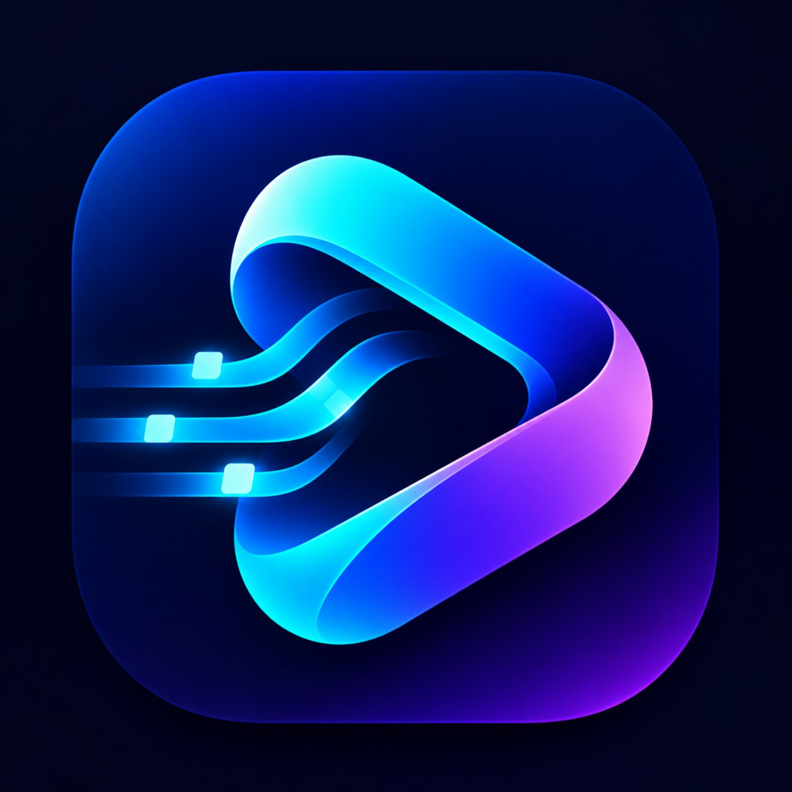

# DownloadZone

### Browse smarter. Download faster. Take control.

**An advanced Android download manager with a built-in GeckoView browser, media downloading tools, and ad blocking.**

### [⬇️ Download the latest APK](https://github.com/Hussein-0p1/DZM-Android-/releases/latest)

[Direct APK download — v1.4.5](https://github.com/Hussein-0p1/DZM-Android-/releases/download/v1.4.5/DownloadZone-1.4.5-release.apk) · [Release notes](https://github.com/Hussein-0p1/DZM-Android-/releases/tag/v1.4.5) · [Report a problem](https://github.com/Hussein-0p1/DZM-Android-/issues)

**[English](#-features) | [العربية](#-بالعربية)**

---

## ✨ Features

| 📥 Advanced downloading | 🎬 Video & audio | 🛡️ Ad blocking | 🌐 GeckoView browser |
|:---|:---|:---|:---|
| Multi-part transfers, queue, scheduling and resume | Supported media sites, quality selection, HLS and subtitles | Network and cosmetic filtering with popup protection | Tabs, private mode, bookmarks, desktop view and toolbar controls |

### 📥 Powerful download manager

- Up to **32 configurable parallel connections** per download, depending on server support.
- Pause, resume, retry and recover eligible downloads after interruptions.
- Background downloading, queue management, time-based scheduling and speed limits.
- Real-time transfer information: total progress, speed, estimated time and **per-part details**.
- Custom filenames and save directories; download search, status filters and file opening.
- Checksum validation (MD5 / SHA-1 / SHA-256), source-link replacement and response integrity handling.

### 🎬 Video, audio and social media

- Media detection and compatible download workflows for **YouTube, Facebook, Instagram and TikTok**.
- Additional media extraction paths for compatible platforms such as **X/Twitter, Dailymotion, Vimeo, Reddit, Twitch and SoundCloud**.
- Choose available video qualities and supported audio options such as **MP3** or **M4A**.
- **yt-dlp** integration, **HLS / M3U8** processing and **FFmpeg** merging when needed.
- Subtitle handling for compatible sources and streams.

> Supported platforms and qualities depend on the specific website, content, account permissions and available formats. DownloadZone does not bypass DRM.

### 🛡️ Built-in ad blocker

- Filtering of known ad-related requests, domains and paths.
- Cosmetic filtering to hide selected ad elements on websites.
- Mitigation of unwanted popups, popunders and redirects.
- On/off control and compatibility handling for certain media players and sites.

### 🌐 Built-in GeckoView browser

- Powered by **Mozilla GeckoView**.
- Up to **12 tabs**, private browsing, ordinary-tab restoration, bookmarks and browsing history.
- Desktop and mobile modes, page search, sharing and configurable start/search options.
- Customizable browser toolbar, fullscreen video and optional background playback.
- Direct handoff of supported downloads from browsing to the download manager.

### 🎨 More functionality

- Light, dark and automatic themes; **Arabic and English** interface.
- Download notifications, Android folder picker and opening supported downloaded APKs.
- Local secure storage of sensitive download credentials using Android Keystore.
- Compatible individual **MEGA** file transfers.

## 📲 Installation

1. Open [**DownloadZone — latest release**](https://github.com/Hussein-0p1/DZM-Android-/releases/latest).
2. In **Assets**, select the file ending in `.apk`.
3. Open the APK on your Android phone, and grant installation permission for the source if requested.
4. Install and launch DownloadZone.

**System requirements:** Android 8.0 (API 26) or later. Release build targets supported ARM32/ARM64 Android devices.

### 🔐 Current release verification

| Release asset | SHA-256 |
|:---|:---|
| `DownloadZone-1.4.5-release.apk` | `562d510bf87a366f124060f537732b4d5a5f5655e7a23d410c260881a339732c` |

This checksum was read from the published v1.4.5 release asset metadata. A matching checksum confirms file consistency with that release asset, not the absence of security risks.

## 🐞 Feedback and bug reports

Please [open an issue](https://github.com/Hussein-0p1/DZM-Android-/issues) with your Android version, device model, app version, steps to reproduce and screenshots if available. **Do not share passwords, account cookies, private links, or tokens.**

## 🇮🇶 بالعربية

**DownloadZone** مدير تحميلات متقدم لأندرويد يجمع **متصفح GeckoView** ويا **محرك تحميل متعدد الأجزاء** و**مانع إعلانات** وميزات تحميل الفيديو والصوت.

- **التحميلات:** حتى 32 اتصالاً حسب دعم الخادم، إيقاف واستئناف، جدولة، طابور تحميل، تحديد سرعة، وتفاصيل كل جزء.
- **الفيديو:** اكتشاف مصادر الوسائط وخيارات تنزيل المواقع المتوافقة مثل يوتيوب وفيسبوك وإنستغرام وتيك توك، واختيار الجودة المتاحة.
- **الصوت والبث:** خيارات MP3 وM4A، ودعم HLS/M3U8 ودمج الصوت والفيديو عندما يكون المصدر مدعوماً.
- **الإعلانات:** فلترة طلبات الإعلانات، إخفاء بعض عناصر الصفحة، وتقليل النوافذ المنبثقة والتحويلات المزعجة.
- **المتصفح:** تبويبات، تصفح خفي، سجل ومفضلة، وضع سطح المكتب، شريط أدوات قابل للتخصيص.
- **الواجهة:** عربي وإنكليزي، مظهر فاتح وداكن، إشعارات وإدارة للملفات المحمّلة.

### [⬇️ حمّل أحدث إصدار](https://github.com/Hussein-0p1/DZM-Android-/releases/latest)

**ملاحظة:** نجاح التنزيل، الاستئناف، الجودات وفعالية مانع الإعلانات يعتمد على الموقع والخادم. حمّل فقط المحتوى الذي تملكه أو المسموح لك بتنزيله.

---

**DownloadZone — Browse. Discover. Download. Manage.**

